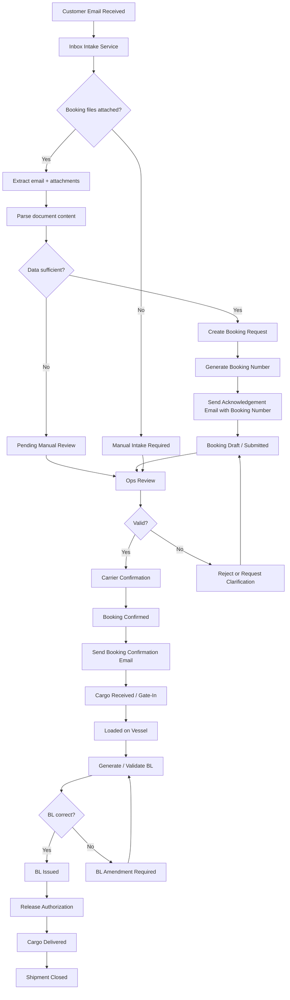

# Booking & BL Process Diagram

## Business process flow

## Notes
- The intake service captures the original email, attachments, and metadata.
- If parsing fails or fields are incomplete, the system creates a booking in Pending Manual Review.
- Every transition should be recorded in a status history log.

## Process explanation
1. A customer sends an email with booking-related files.
2. The system reads the message and attachments.
3. Relevant shipment information is extracted.
4. The booking is created and placed in Pending Manual Review when details are sufficient.
5. Operations validates the booking and confirms carrier capacity.
6. Cargo is moved, loaded, and the BL is issued.
7. Any BL mismatch triggers amendment handling.
8. Final delivery closes the workflow.
